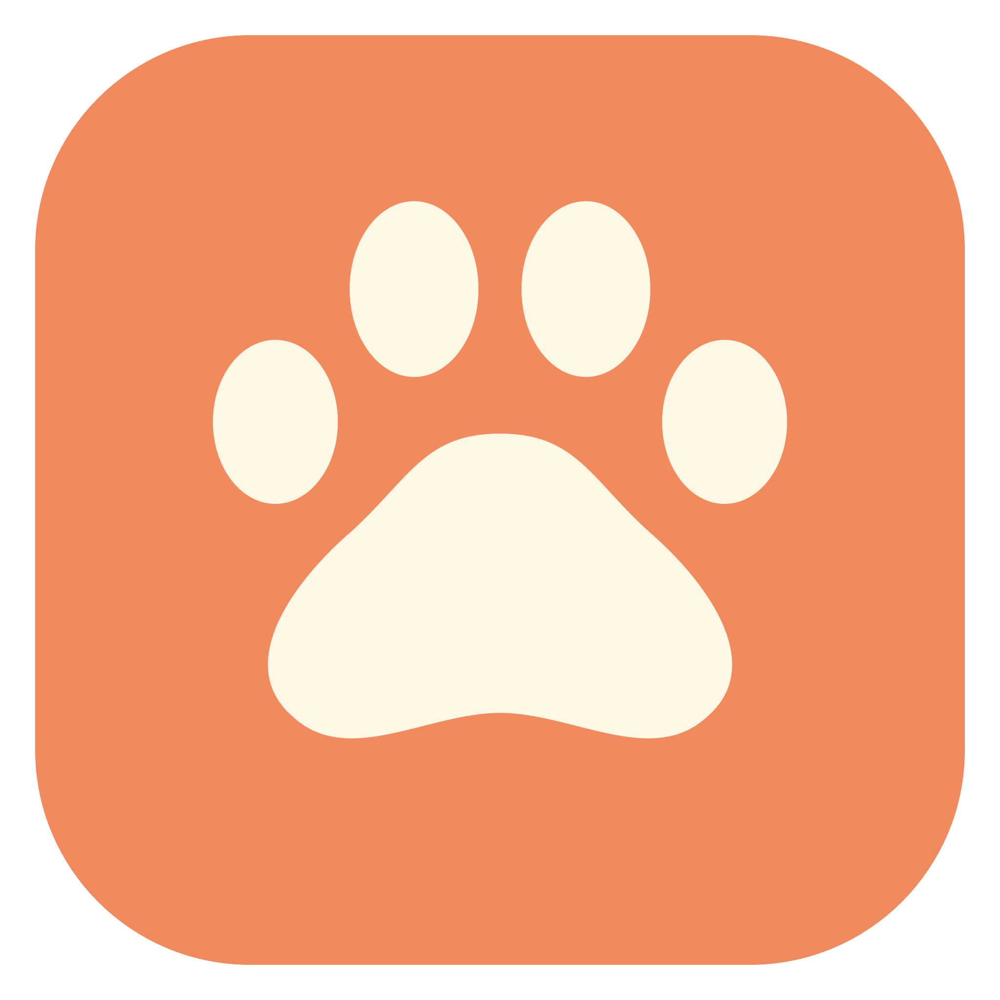

<p align="center"></p>
<h1 align="center">爪爪 · ZhuaZhua</h1>
<p align="center">把看到的资料抓住，把图片里的文字找回来。</p>

原生 macOS 截图收集与本地 OCR 检索工具。Swift、SwiftUI、AppKit 和 Apple Vision，无第三方 Swift 包依赖。

## 已实现

- 屏幕顶部截图收纳栏，点击或下拉打开整理抽屉。
- 顶部「＋ 拖入图片」支持图片文件和图片数据拖入；点击可粘贴剪贴板图片或选择文件。浏览器若仅提供 URL，请先使用“复制图片”。
- 本地保存独立图片副本，后台识别简体中文、繁体中文和英文。
- 搜索图片文字、文件名、备注与标签；显示命中文字片段。
- 顶部图片单击复制、双击或右上角放大镜打开苹果原生 Quick Look；左右键翻图，空格/Esc 关闭。
- 大图连续预览、备注编辑、批量标签、标签去重与一次撤销。
- 自定义截图、收纳栏、搜索及设置快捷键。

## 开发运行

需要 macOS 14+、Swift 工具链与 Command Line Tools。

```sh
swift test
SIGN_IDENTITY=- scripts/build-app.sh debug
open build/ZhuaZhua.app
```

构建脚本产出 Apple silicon / Intel 通用应用。当前没有经 Developer ID 签名、公证的发行包；这是早期源码版本。

## 数据与联网

图片和 OCR 在本机处理，默认不上传。历史兼容目录为 `~/Library/Application Support/QiuyiwuCapture/`，截图收件目录为 `~/Library/Application Support/Tendedero/Screenshots/`。保留现有 Bundle ID `com.qiuyiwu.capture`，以延续用户设置。

目前保留一个面向 `qiuyiwu.com` 的实验性网站适配：需主动登录、选择工作区并上传，自动上传默认关闭。它不是通用云服务，不附带网站后台、账号或云密钥。COS 和数据库同步尚未实现。不要把任何凭据提交到仓库。

## 边界与后续

OCR 可能有错字；大量图库性能和跨屏快捷键仍需更多验证。后续计划包括来源网址、缩略图缓存、可配置的云端同步。

## 来源与许可

本项目基于 [Alejandro Buján 的 Tendedero](https://github.com/alejandrobujan/tendedero)，上游源码快照见 `SOURCE-SNAPSHOT.json`。保留上游 MIT 版权与许可；本项目与上游作者不存在背书关系。

爪爪采用独立名称与新图标，不分发上游受保留的图标作品。新增代码及 `assets/brand/` 中的爪爪图形同样以 MIT 许可提供。内部 Swift target 名称暂保留 Tendedero 以兼容现有测试和构建。

### 时间与顶部排列

顶部保留图片原始比例、顶边对齐，以中央添加区为轴恢复原版固定排列节奏，只额外预留中央添加位，保留横向滚动，展示当前屏幕容纳的最近图片；完整记录从“搜索与整理”查看。抽屉支持按本机日历日期筛选收集或整理记录。收集时间沿用首次入库时间；整理时间从本版本开始，在实际修改备注或标签时追加，OCR 不算人工整理，历史缺失时间不推断。
